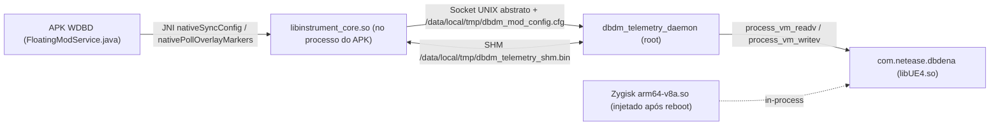

# Estrutura e Funcionamento do Módulo Zygisk + Daemon + APK WDBD

Este documento descreve a arquitetura atual do projeto `ida95-dbdm-suite`, como o módulo nativo (`libinstrument_core.so` / `dbdm_telemetry_daemon`) e o APK (`wdbd.apk`) se organizam e como ocorre a comunicação entre eles e o jogo `com.netease.dbdena`.

---

## 1. Visão Geral da Arquitetura (3 Camadas)

O sistema funciona de forma **headless** (sem hooks gráficos EGL/ImGui dentro do jogo) e é dividido em três partes:

1. **Módulo Magisk/Zygisk (`ue4_instrument_zygisk.zip`)**
   * Carregado pelo Zygisk dentro de `com.netease.dbdena` (`zygisk/arm64-v8a.so`, compilado a partir de `libinstrument_core.so`).
   * Também instala e inicia o serviço auxiliar (`service.sh`) caso o daemon esteja presente.
2. **Daemon Root Externo (`dbdm_telemetry_daemon`)**
   * Compilado a partir do mesmo código-fonte (`jni/core/entry.cpp`), rodando em background como `root`.
   * Anexa ao PID de `com.netease.dbdena` e lê/escreve memória do processo do jogo via `process_vm_readv` / `process_vm_writev`.
3. **APK Standalone (`wdbd.apk` / `DBDM_FloatingModMenu.apk`)**
   * Pacote Android `com.dbdm.modmenu`, responsável pela interface flutuante (menu e overlay 2D/3D ESP) usando `WindowManager` (`TYPE_APPLICATION_OVERLAY`), sem injetar UI no processo do jogo.
   * Carrega `libinstrument_core.so` via JNI para trocar pacotes IPC com o backend e gravar configurações/logs.

---

## 2. Estrutura de Diretórios do Projeto

### 2.1 Camada Nativa C++20 (`jni/`)

* **`jni/core/`**
  * `entry.cpp`: núcleo principal (Zygisk entry `zygisk_module_entry`, daemon `--daemon`, loop `telemetry_worker_entry` -> `execute_diagnostic_tick()`, leitura/escrita UE4, projeção 3D->2D e exports JNI para o APK).
  * `exports.map`: tabela de símbolos exportados (`JNI_OnLoad`, `zygisk_module_entry`, `nativeSyncConfig`, `nativeGetStatus`, `nativePollOverlayMarkers`, `nativeStartCrashLogger`, `nativeStopCrashLogger`, `nativeLogModAction`).
  * `elf_resolver.hpp`: resolução de módulos em memória (`elf::find_module("libUE4.so")`).
  * `in_process_memory.hpp`: abstração segura de leitura/escrita (`process_vm_readv`/`process_vm_writev` no daemon e acesso direto in-process no Zygisk).
  * `zygisk.hpp`, `visibility.hpp`, `aob_scanner.hpp`, `egl_plt_bridge.hpp`, `ue4_runtime_pipeline.hpp`, `ue4_aarch64_unified_diagnostics.hpp`.
* **`jni/telemetry/`**
  * `ipc_shared_state.hpp`: estruturas de pacote IPC (`ControlPayload`, `TelemetrySnapshotPayload`), socket UNIX abstrato, arquivo compartilhado `/data/local/tmp/dbdm_telemetry_shm.bin` e parser do payload `@gp:...`.
  * `telemetry_adapter.hpp`: adaptação de estados de jogo (`ImmobilizeState`, `PlayerRole`).
  * `scene_collector_helpers.hpp`: coleta de atores/entidades na cena (`ULevel::Actors`).
  * `diagnostic_tick_bridge.hpp`: ponte de execução do tick diagnóstico.
  * `crash_logger.hpp`: sistema append-only de gravação de logs (`SIGSEGV`/`SIGABRT`/`SIGBUS`/`SIGILL`/`SIGFPE`, hooks UE4 in-process, espelho de logcat e registro de ações).
* **`jni/hud/`**
  * `math3d_pipeline.hpp`: matemática de câmera/projeção 3D -> 2D (`WorldToScreen`).
  * `imgui_gles3_hud.hpp` / `.cpp`: definições compartilhadas (`SceneTelemetryData`, `GameplayManipulationConfig`, constantes de categoria).

### 2.2 Módulo Magisk/Zygisk (`zygisk/`)

* `module.prop`: metadados do módulo Magisk/KernelSU.
* `customize.sh`: script de instalação do ZIP no Magisk/KernelSU.
* `service.sh`: executa no boot, ajusta permissões de `/data/local/tmp` (`1777`), `/data/local/tmp/dbdm_mod_config.cfg` e `/data/local/tmp/dbdm_telemetry_shm.bin` (`0666`), e inicia `/data/local/tmp/dbdm_telemetry_daemon --daemon`.
* `META-INF/com/google/android/update-binary` & `updater-script`: instalador padrão de módulo ZIP.

### 2.3 Aplicativo Android (`app/`)

* `AndroidManifest.xml`: declara pacote `com.dbdm.modmenu`, permissões `SYSTEM_ALERT_WINDOW`, `FOREGROUND_SERVICE`, `QUERY_ALL_PACKAGES`, `READ_EXTERNAL_STORAGE`, `WRITE_EXTERNAL_STORAGE`, `MANAGE_EXTERNAL_STORAGE` e `requestLegacyExternalStorage="true"`.
* `src/com/dbdm/modmenu/MainActivity.java`: tela inicial que verifica/solicita permissão de sobreposição e inicia o `FloatingModService`.
* `src/com/dbdm/modmenu/FloatingModService.java`:
  * **Overlay ESP (`AuraEspOverlayView`)**: desenha caixas/rótulos/distâncias projetados em 2D sobre a tela inteira (`FLAG_NOT_FOCUSABLE | FLAG_NOT_TOUCHABLE`).
  * **Menu Flutuante (`WDBD`)**: bolha recolhível + painel com 3 abas (**Visual**, **Física**, **Identidade**) e botão **`LOG`** / **`REC`** na barra superior.
  * **Polling de UI**: consulta `nativeGetStatus()` e `nativePollOverlayMarkers(...)` periodicamente para atualizar o banner de status e os marcadores na tela.
* `assets/`: ícones/logos (`wdbd_logo_circle.png`, `logo.jpg`).

---

## 3. Como Tudo Funciona em Execução

### Fluxo passo a passo:

1. **Inicialização e Descoberta do Jogo**
   * O `dbdm_telemetry_daemon` (iniciado pelo `service.sh` ou pelo deploy ADB) procura o processo `com.netease.dbdena` e resolve a base de `libUE4.so` em memória (`elf::find_module("libUE4.so")`).
   * A partir da base da `libUE4.so`, resolve os ponteiros globais configurados em `EngineOffsets` (`GWorld` `+0x10D69998`, `GNamePool` `+0x10B7C100`, `GUObjectArray` `+0x10BF7920`, `GEngine` `+0x10D65798`).
2. **Loop de Telemetria (`execute_diagnostic_tick`, ~16 ms)**
   * Lê `poll_external_mod_menu_config()` para sincronizar configurações vindas do APK (`/data/local/tmp/dbdm_mod_config.cfg`).
   * Percorre `UWorld -> PersistentLevel -> Actors`, identifica jogadores (Killer / Survivor), geradores (`NativePercentComplete`), hatch (`AHatch`), totens, baús, pallets, ganchos e portões de saída.
   * Escreve o snapshot de posições/câmera no canal IPC (`TelemetrySnapshotPayload` / `/data/local/tmp/dbdm_telemetry_shm.bin`).
   * Aplica modificações ativas da aba **Física** / **Visual** / **Identidade** (velocidade, aceleração, pulo, escala de tempo, FOV, imunidade a armadilha, fly, imobilização, papel, nome e `apply_force_escape`).
3. **Sincronização APK <-> Backend**
   * Quando o usuário marca uma opção ou aperta **Sair Instantâneo**, `FloatingModService.java` monta o payload compacto `@gp:...` e chama `nativeSyncConfig(...)`.
   * `nativeSyncConfig` envia o `ControlPayload` via socket IPC e também grava `/data/local/tmp/dbdm_mod_config.cfg`.
   * A cada frame do overlay, `AuraEspOverlayView` chama `nativePollOverlayMarkers(...)`, que projeta as coordenadas 3D recebidas do snapshot para 2D e retorna `[screen_x, screen_y, distance_m, category_id, extra]` para desenho no Canvas Android.
4. **Sistema de Gravação de Logs (`LOG` / `REC`)**
   * Ao tocar em **`LOG`**, o APK chama `nativeStartCrashLogger("/sdcard/DBDMod/logs", fallbackDir)`, criando `/sdcard/DBDMod/logs/dbdm_crash_YYYYMMDD_HHMMSS.log`.
   * O estado (`crash_log_active=1`, `crash_log_path=...`) é gravado no `.cfg` e anexado automaticamente pelo daemon (e pelo Zygisk in-process, quando carregado após reinício da VM) via `attach_session_path`.

---

## 4. Build e Empacotamento (`CMakeLists.txt` + `build_module.ps1`)

O script `build_module.ps1` executa 6 etapas:
1. Limpa caches de build (`build-arm64/` e `app/build/`).
2. Compila com Android NDK r27 (`arm64-v8a`, C++20) os alvos `libinstrument_core.so`, `dbdm_telemetry_daemon` e `libue4_diagnostics.so`.
3. Faz *strip* e valida os símbolos exportados com `llvm-nm` (conferindo `exports.map`).
4. Monta e compacta `modulos/ue4_instrument_zygisk.zip` (copiando `libinstrument_core.so` para `zygisk/arm64-v8a.so`).
5. Compila, alinha (`zipalign`) e assina (`apksigner`) `modulos/wdbd.apk` (espelhado em `modulos/DBDM_FloatingModMenu.apk`), embutindo `libinstrument_core.so` em `lib/arm64-v8a/`.
6. Implanta na VM via ADB (`192.168.1.68:10001`), reinicia o `dbdm_telemetry_daemon` e instala/inicia o APK.

