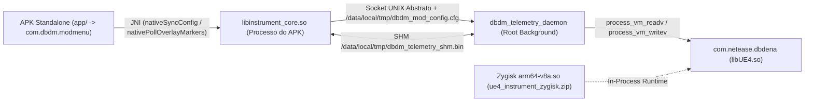

# IDA 9.5 DBDM Suite & UE4.27 AArch64 Instrumentation

Suíte integrada de engenharia reversa estática (IDA Pro 9.x) e instrumentação dinâmica em tempo de execução (Zygisk + Daemon Root + Overlay APK) voltada ao **Dead by Daylight Mobile** (`com.netease.dbdena`, Unreal Engine 4.27, ELF64 AArch64 / `arm64-v8a`).

---

## 1. Arquitetura do Sistema (3 Camadas)



1. **Camada Nativa C++20 (`jni/`)**
   - Compila três alvos a partir da mesma árvore de código via Android NDK r27 (`C++20`, `-O3`, `-flto=thin`):
     - `libinstrument_core.so`: biblioteca compartilhada que atua tanto como módulo Zygisk (`zygisk_module_entry`) quanto como ponte JNI do aplicativo Android (`JNI_OnLoad`).
     - `dbdm_telemetry_daemon`: executável standalone em modo root (`--daemon`) que realiza leitura e escrita de memória out-of-process via `process_vm_readv` / `process_vm_writev`.
     - `libue4_diagnostics.so`: biblioteca unificada de diagnóstico e inspeção UE4.
2. **Aplicativo Android de Overlay & Menu Flutuante (`app/`)**
   - Pacote standalone `com.dbdm.modmenu` (`wdbd.apk`), renderizando o menu flutuante (**WDBD**) e o overlay 2D/3D ESP via `WindowManager` (`TYPE_APPLICATION_OVERLAY`), sem injetar hooks gráficos EGL/ImGui dentro do processo do jogo.
3. **Suíte Python para IDA Pro 9.x (`ida95_dbdm_suite/` & `ida95_dbdm_suite_plugin.py`)**
   - Resolução de assinaturas ARM64 (`ADRP`/`ADD`/`LDR`), reconstrução de tipos `tinfo_t` (`UObject`, `UStruct`, `UClass`, `UFunction`, `FNamePool`, `FUObjectArray`), exportação de SDK C++20 e validadores determinísticos de eventos de tempo (`USkillCheck`).

---

## 2. Estrutura de Diretórios

```text
ida95-dbdm-suite/
├── README.md                           # Visão geral, arquitetura, estrutura e guia rápido de build
├── CMakeLists.txt                      # Configuração principal do CMake (NDK r27, C++20, arm64-v8a)
├── build_module.ps1                    # Atalho na raiz que invoca scripts/build_module.ps1
├── ida95_dbdm_suite_plugin.py          # Entrypoint do plugin para IDA Pro 9.x (Ctrl-Shift-D)
│
├── jni/                                # Código-fonte nativo C++20
│   ├── core/                           # Entrypoint Zygisk/Daemon, AOB scanner, ELF resolver, memória e pipeline UE4
│   ├── hud/                            # Matemática de projeção 3D->2D (WorldToScreen) e estruturas de HUD
│   ├── telemetry/                      # Estado compartilhado IPC, crash logger, outline controller e timing validator
│   └── third_party/                    # Dependências externas (Dear ImGui)
│
├── app/                                # Código-fonte do aplicativo Android (com.dbdm.modmenu)
│   ├── AndroidManifest.xml
│   ├── build.gradle
│   ├── assets/                         # Ícones e recursos visuais embutidos no APK
│   ├── res/                            # Layouts e strings Android
│   └── src/com/dbdm/modmenu/           # MainActivity.java & FloatingModService.java
│
├── zygisk/                             # Scripts e metadados do módulo Magisk/Zygisk (module.prop, customize.sh, service.sh)
│
├── ida95_dbdm_suite/                   # Pacote Python da suíte de engenharia reversa e validação
│   ├── __init__.py
│   ├── arm64_resolver.py               # Decodificador de instruções AArch64 (ADRP/ADD/LDR/BL)
│   ├── dbdm_config.py                  # Offsets e especificações de assinaturas UE4.27
│   ├── ida95_types.py                  # Construtor de estruturas tinfo_t para IDA 9.x
│   ├── sdk_exporter.py                 # Gerador de headers C++20 a partir do banco do IDA
│   ├── ue4_analyzer.py                 # Analisador de GUObjectArray, FNamePool e UFunctions
│   ├── ui_timing_controller.py         # Controlador determinístico de eventos de tempo (Stage 7)
│   └── inspect_skillcheck.py           # Mapeamento e verificação de RVAs/offsets de USkillCheck
│
├── scripts/                            # Automação de Build, Empacotamento e Deploy
│   ├── build_module.ps1                # Pipeline completo (CMake + Strip + Magisk ZIP + APK + ADB Deploy)
│   ├── build_module.sh                 # Pipeline de build para ambientes Linux/POSIX
│   ├── deploy_adb.py                   # Implantação automatizada via ADB na VM/dispositivo
│   └── tools_bin/                      # Utilitários de build locais (ninja.exe)
│
├── tools/                              # Scripts auxiliares de análise estática e engenharia reversa
│   └── re_scripts/
│       ├── outline_and_classes/        # Scripts de inspeção de FClass, vtables e UOutlineComponent
│       ├── skillcheck/                 # Scripts de extração de propriedades, triggers e ASM de USkillCheck
│       └── dumps/                      # Dumps textuais de classes, símbolos e descompilações
│
├── binaries/                           # Binários ELF64 e bases IDA (.i64) usados para análise offline
│
├── modulos/                            # Artefatos compilados prontos para distribuição e deploy
│   ├── ue4_instrument_zygisk.zip       # Módulo Magisk/Zygisk flashável
│   ├── wdbd.apk                        # APK assinado do Floating Mod Menu (espelhado em DBDM_FloatingModMenu.apk)
│   ├── libinstrument_core.so           # Biblioteca nativa principal stripped
│   ├── libue4_diagnostics.so           # Biblioteca de diagnóstico unificado stripped
│   ├── dbdm_telemetry_daemon           # Executável do daemon root standalone
│   └── ue4_instrument_zygisk/          # Diretório de staging limpo do pacote Magisk
│
├── switcher_src/                       # Árvore Apktool do Switcher Android 11
│
└── docs/                               # Documentação técnica organizada por domínio
    ├── architecture/                   # Arquitetura detalhada do módulo/APK e reconciliação de movimento UE4
    ├── guides/                         # Guias passo a passo de instalação e uso
    ├── reports/                        # Relatórios técnicos de engenharia reversa e histórico de revisões
    ├── server_audit/                   # Auditoria de superfície de rede, autenticação, DTOs e payloads
    ├── specs/                          # Especificações de estágios de engenharia reversa
    └── logs/                           # Logs de sessão e crash capturados em testes
```

---

## 3. Como Compilar e Implantar

### Build Completo + Deploy ADB (Windows PowerShell)

Na raiz do repositório, execute:

```powershell
.\build_module.ps1
```

O script executa automaticamente as 6 etapas:
1. Limpa caches temporários (`build-arm64/` e `app/build/`).
2. Compila `libinstrument_core.so`, `dbdm_telemetry_daemon` e `libue4_diagnostics.so` via CMake + Ninja + NDK r27 (`arm64-v8a`).
3. Remove símbolos internos (`llvm-strip --strip-unneeded`) e audita a tabela dinâmica de exportação (`llvm-nm`).
4. Gera o pacote flashável Magisk/Zygisk em `modulos/ue4_instrument_zygisk.zip`.
5. Compila, alinha (`zipalign`) e assina (`apksigner`) o aplicativo Android em `modulos/wdbd.apk`.
6. Caso o dispositivo/VM esteja acessível via ADB, realiza a instalação limpa do módulo, inicia o `dbdm_telemetry_daemon` e instala/abre o APK.

### Executar Testes de Validação da Suíte Python

```powershell
python .\ida95_dbdm_suite_plugin.py
python -m ida95_dbdm_suite.inspect_skillcheck
```

---

## 4. Índice de Documentação (`docs/`)

- **Arquitetura:**
  - [Estrutura e Funcionamento do Módulo Zygisk + Daemon + APK](docs/architecture/ESTRUTURA_MODULO_E_APK.md)
  - [Reconciliação de Movimento UE4](docs/architecture/reconciliacao_movimento_ue4.md)
- **Guias de Operação:**
  - [Como Usar e Instalar o Módulo](docs/guides/COMO_USAR_MODULO.md)
- **Relatórios Técnicos e Auditoria:**
  - [Análise Completa DBD Mobile](docs/reports/ANALISE_COMPLETA_DBD_MOBILE.md)
  - [Relatório Rev7 Completo](docs/reports/RELATORIO_REV7_COMPLETO.md)
  - [Relatório AOB Scan](docs/reports/relatorio_aob_scan.md)
  - [Relatório Entry NDK](docs/reports/relatorio_entry_ndk.md)
  - [Auditoria de Servidor (Sumário)](docs/server_audit/01_summary.md)

